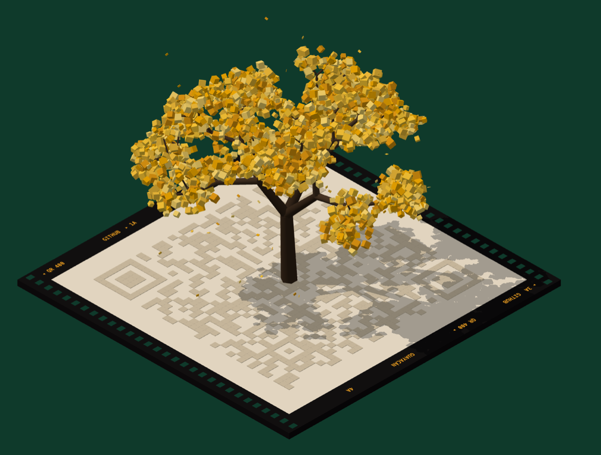

# QR Tree

A QR code that grows into a tree. Tap the tree and every blossom falls into a module of the code, the branches pull back into the ground, and the camera swings overhead so the code can be scanned. Tap again and the tree grows back.

<p align="center">
  
  
</p>

- **Real QR codes.** The blossoms land exactly on the code's dark modules, with error correction level H and a full quiet zone, so phones read it.
- **Four trees** from Quito and Miami: the yellow guayacán, the blue jacaranda, the royal palm and the red flamboyán. Each has its own shape and palette, and you can recolour any of them.
- **The same input always grows the same tree.** The shape is seeded from the text.
- **Plain JS or React.** One class drives a `<canvas>`; a small React component wraps it.
- **Easy on the page.** It stops rendering while off screen, resizes with its canvas, and respects `prefers-reduced-motion`.

Built with [three.js](https://threejs.org) and [node-qrcode](https://github.com/soldair/node-qrcode).

## Install

```sh
npm install qr-tree three
```

`three` is a peer dependency. React 18 or newer is only needed for `qr-tree/react`.

## Usage

### Plain JavaScript

```html
<canvas id="tree" style="width: 100%; height: 600px"></canvas>
```

```ts
import { QRTree } from "qr-tree";

const canvas = document.getElementById("tree") as HTMLCanvasElement;
const tree = new QRTree(canvas, { value: "https://example.com", kind: "jacaranda", label: "Website" });

canvas.addEventListener("click", () => tree.toggle());
```

Plant a different tree, growing it up out of its code:

```ts
tree.show("mailto:hello@example.com", { kind: "flamboyan", label: "Email" });
tree.jump("code");
tree.setMode("tree");
```

Call `tree.dispose()` when you remove the canvas.

### React

```tsx
import { QRTree } from "qr-tree/react";

export function Contact() {
  return <QRTree value="https://example.com" kind="palm" label="Website" style={{ width: "100%", height: 600 }} />;
}
```

It toggles itself on click and on Enter or Space. To control it yourself, pass `mode` and `onModeChange`:

```tsx
const [mode, setMode] = useState<Mode>("tree");

<QRTree value={url} mode={mode} onModeChange={setMode} />
<button onClick={() => setMode(mode === "tree" ? "code" : "tree")}>Show the QR code</button>
```

Changing `value`, `kind` or `label` grows a new tree. Any other canvas props (`className`, `style`, `aria-label`…) pass through. The component only runs in the browser, so in Next.js use it from a `"use client"` file.

## API

### `new QRTree(canvas, options)`

| Option | Type | Default | |
| --- | --- | --- | --- |
| `value` | `string` | required | The text or URL to encode. |
| `kind` | `"guayacan" \| "jacaranda" \| "palm" \| "flamboyan"` | `"guayacan"` | Which tree to grow. |
| `label` | `string` | the tree's name | Printed along the film edge. |
| `look` | `Partial<Look>` | | Recolour the tree: `bloom`, `deep`, `bark`. |
| `edgeText` | `[string[], string[]] \| false` | | The two lines of film edge print, or `false` for none. |
| `film` | `Partial<Film>` | | Recolour the film: `ink`, `paper`, `print`, `hole`, `edge`. |
| `mode` | `"tree" \| "code"` | `"tree"` | Where to start. |
| `duration` | `number` | `1.15` | Seconds for a full tree ↔ code transition. |
| `shadows` | `boolean` | `true` | Soft shadows while the tree stands. |
| `maxPixelRatio` | `number` | `2` | Cap on the device pixel ratio. |
| `autoResize` | `boolean` | `true` | Resize with the canvas's CSS size. |
| `pauseOffscreen` | `boolean` | `true` | Stop rendering while the canvas is off screen. |
| `reducedMotion` | `boolean` | user setting | Snap between modes and keep the tree still. |

| Method | |
| --- | --- |
| `show(value, { kind, label, look, edgeText })` | Plants a new tree. Keeps the current mode. |
| `setMode(mode)` | Animates to `"tree"` or `"code"`. |
| `toggle()` | Animates to the other mode and returns it. |
| `jump(mode)` | Snaps to a mode with no transition. |
| `mode` | The mode it is in, or heading to. |
| `setPaused(paused)` | Stops or restarts rendering. |
| `resize()` | Matches the canvas size. Only needed with `autoResize: false`. |
| `dispose()` | Frees the GPU resources. |

The package also exports `LOOKS` and `KINDS` (the four trees and their palettes, handy for matching UI colours), `FILM` (the default film colours) and `encode(text)` (the QR modules the tree is built from).

### Custom colours

```ts
new QRTree(canvas, {
  value: "https://example.com",
  kind: "jacaranda",
  look: { bloom: ["#ff8fab", "#ffb3c6", "#fb6f92"], deep: ["#3d0a1a"] },
  film: { paper: "#ffffff", edge: "#ff8fab" },
});
```

Keep `deep` dark and `paper` light: the code needs strong contrast to scan.

## Tips

- **Shorter text, faster tree.** Every dark module gets four blossoms, so a long URL means a bigger code and more blossoms to draw. A link shortener keeps it light.
- **Give it room.** The scene fits itself to the canvas, so any size works, but a square-ish canvas around 500–700px shows it best.
- **Scanning from a screen.** Show the code mode at a comfortable size. Level H error correction covers the blossoms' slight colour variation.

## Development

```sh
npm install
npm run dev        # demo pages at http://localhost:5173 (plain JS and React)
npm test           # checks that the codes decode back to their text
npm run typecheck
npm run build      # ESM + CJS + types into dist/
```

The source is small:

| File | |
| --- | --- |
| `src/scene.ts` | The `QRTree` class: renderer, camera, lighting, film and the tree ↔ code animation. |
| `src/trees.ts` | The four tree growers, seeded so each input always grows the same tree. |
| `src/looks.ts` | Palettes for each tree. |
| `src/code.ts` | QR encoding and module positions. |
| `src/react.tsx` | The React component. |

Contributions are welcome; see [CONTRIBUTING.md](CONTRIBUTING.md).

## Credits

Made by [Susana Rojas](https://github.com/SRojas22), first for the contact section of a personal portfolio site. The idea of a tree that folds into its QR code comes from [tree.icqr.com](https://tree.icqr.com).

## License

[MIT](LICENSE)
